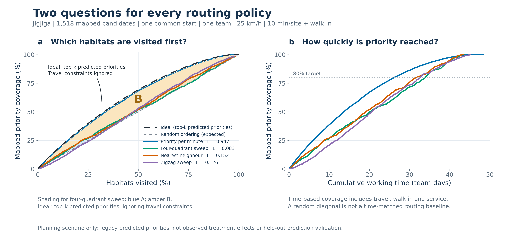
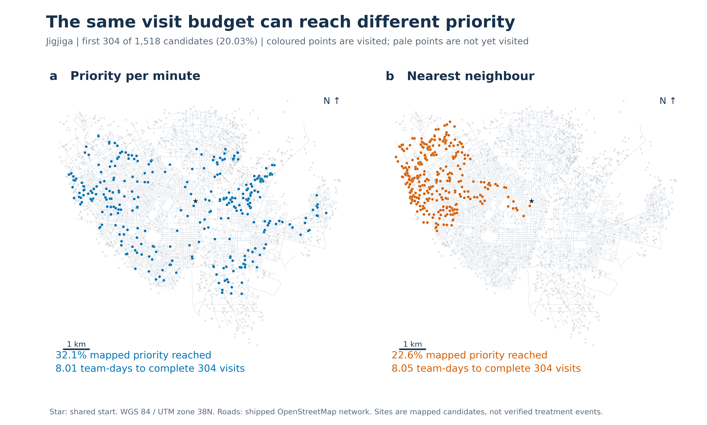
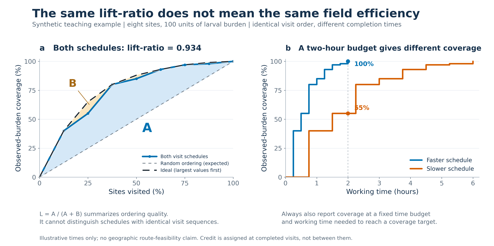
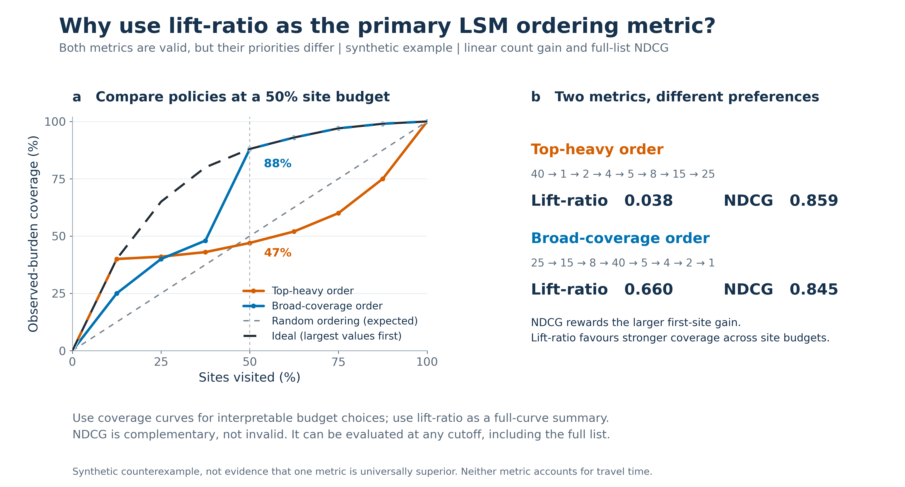
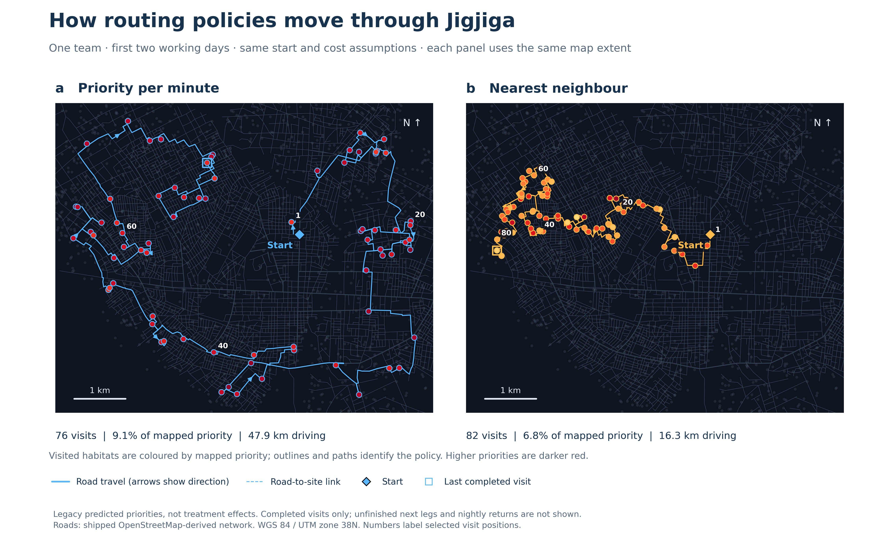
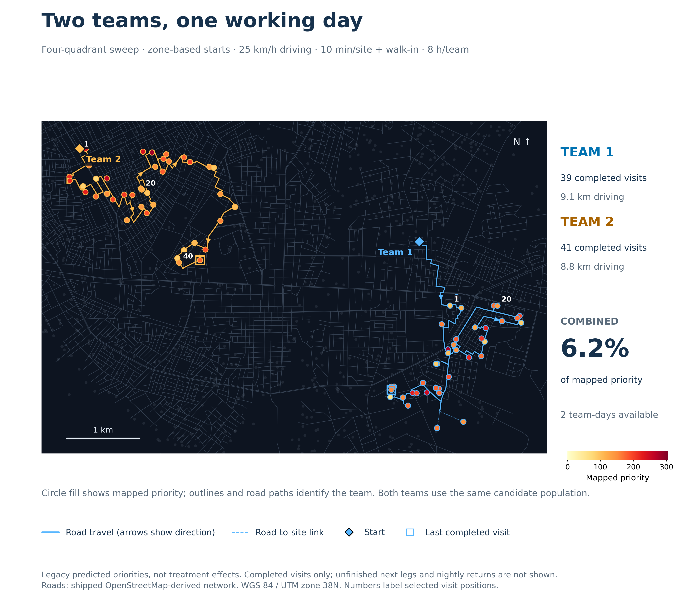

# Assessing routing policies with lift-ratio

Original scientific figures, regenerated from the local routing dashboard and explicit synthetic examples. These are not screenshots. All figures have editable SVG and 300-dpi PNG versions in `figures/`.

## What to show decision-makers

1. **Coverage versus sites visited:** which policy brings more larval value forward for the same number of visits? Summarize the complete order with lift-ratio.
2. **Coverage versus working time:** which policy reaches more value under the same resource budget? Report coverage at a chosen budget and time to a chosen coverage target.
3. **A spatial view:** where do those early visits occur, and what access or geographic equity concerns need field review?

Do not treat lift-ratio as a routing optimality gap or a measure of lives, money or larvae saved. A high-lift route can require more driving. Two schedules with the same visit order have the same lift even when one takes longer.

## Figure 1. Two questions for every routing policy



**Caption.** Site-based prioritization and resource-based coverage for four routing heuristics applied to the same 1,518 mapped candidate sites in Jigjiga. The left panel uses complete visit sequences, with mapped priority as the evaluation weight. Lift-ratio is the area advantage over uniform random site-order expectation divided by the area advantage of ideal priority ordering. The dashed ideal reference ignores road constraints and is not a feasible-route optimum. The right panel credits priority only when site service is completed, using the same depot, one team, 25 km/h driving, 4.3 km/h walk-in, ten minutes of service per site and eight working hours per team-day. Curves use the original computed points, not smoothing. Both panels evaluate legacy mapped priorities, not independently observed larval burden or treatment effects.

| Policy | Lift-ratio | Full-list NDCG | Priority at 50% of sites | Priority after 20 team-days | Team-days to 80% priority |
| --- | ---: | ---: | ---: | ---: | ---: |
| Priority per minute | 0.947 | 0.990 | 68.4% | 67.0% | 26.14 |
| Four-quadrant sweep | 0.083 | 0.921 | 52.0% | 49.6% | 33.83 |
| Nearest neighbour | 0.152 | 0.932 | 52.1% | 51.9% | 31.67 |
| Zigzag sweep | 0.126 | 0.898 | 53.0% | 48.3% | 32.60 |

The nearest-neighbour policy has higher full-range lift than zigzag, but slightly lower coverage at the 50% site budget. This is why the chosen budget and the full curve should accompany the summary score. NDCG and lift-ratio have different reference points; their raw numerical magnitudes are not directly comparable.

## Figure 2. Where the early visits occur



**Caption.** Spatial distribution of the first 304 completed visits, or 20.03% of the common candidate population, under priority-per-minute and nearest-neighbour routing. Coloured points show visited candidates; pale points show candidates not yet visited. The common start is marked by a star. These visits account for 32.1% and 22.6% of the mapped priority, respectively, after 8.01 and 8.05 team-days. Coordinates are projected to WGS 84 / UTM zone 38N (EPSG:32638). The road background is redrawn from the shipped OpenStreetMap-derived network; it is not a screenshot. The points identify visit sets, not route trajectories or verified habitat status. Inspect field accessibility separately.

## Figure 3. Why lift-ratio alone is insufficient



**Caption.** A synthetic eight-site example separates ordering quality from deployment efficiency. Counts in visit order are 40, 15, 25, 5, 8, 4, 1 and 2, totalling 100. Both schedules follow this order and therefore have lift-ratio 0.934. Completing one visit every 15 minutes reaches all 100 units by two hours; completing one every 45 minutes reaches only 55 units by that time. These times are illustrative and do not imply geographic feasibility. Blue A represents gain above random expectation; amber B represents the remaining gain to ideal ordering. Time-based coverage is a completion-event staircase; site-based areas use the stated trapezoidal convention.

## Figure 4. Why not use NDCG alone?



**Caption.** Two synthetic visit orders on the same eight habitats illustrate different metric preferences. The top-heavy order begins with the largest habitat and achieves higher full-list NDCG, 0.859 versus 0.845. The broad-coverage order reaches 88% rather than 47% of the burden after four visits, and has higher lift-ratio, 0.660 versus 0.038. NDCG uses linear count gain and discount 1/log2(r+1), where r is visit position, and is normalized by the ideal discounted gain. No top-k truncation is used. This counterexample demonstrates different objectives, not universal superiority of either metric.

NDCG originated in information retrieval and is useful when position-discounted gain matches the decision objective. It is not restricted to a few positions and can assess a full list. Our LSM evaluation framework does not prescribe a cutoff: it presents coverage across all feasible site and resource budgets so decision-makers can compare policies and choose an appropriate coverage level. The 50% site budget in Figure 4 is one illustrative reading from the full curve, not a recommended treatment threshold. Lift-ratio summarizes ordering performance without selecting a top-k cutoff, but still has a weighting assumption: equal increments of site share receive equal weight in the full-curve integral. Retain the curves because a higher full-range lift need not imply better coverage at every budget. Use NDCG as a complementary sensitivity measure and time-based coverage to inform resource choices.

Sources: [Järvelin and Kekäläinen (2002)](https://doi.org/10.1145/582415.582418) explains discounted gain and ideal normalization; [scikit-learn NDCG documentation](https://scikit-learn.org/stable/modules/generated/sklearn.metrics.ndcg_score.html) documents the linear-gain implementation and optional cutoff. The planning interpretation and numerical examples here are our analysis.

## Additional route-path figures



**Route-map caption.** Priority-per-minute and nearest-neighbour policies use the same start and two-day, one-team budget. They complete 76 and 82 visits, reach 9.1% and 6.8% of mapped priority, and drive 47.9 and 16.3 km, respectively. Paths follow directed road-network shortest paths; arrows indicate direction. Diamonds indicate starts and squares the last completed visits. Sparse numbers label visit positions. Circle fill shows mapped priority, while outlines and lines identify policies. Only inbound legs of completed visits are shown. Dashed access connectors are schematic road-to-site links, not independently surveyed walking routes.



**Two-team caption.** One eight-hour day for each of two four-quadrant sweep teams produces 39 and 41 completed visits, reaching 6.2% of mapped priority with 17.9 km of combined driving. Starts are assigned geographically; the starting zones differ from the four quadrants used to allocate work. A quadrant is assigned to one team until cleared, but travel can cross its boundary. Blue and amber paths identify the teams. Different starts and policies mean this is not a controlled test of the effect of team count. Both maps use WGS 84 / UTM zone 38N and legacy mapped priorities, not verified treatment outcomes. They were generated from graph geometry, not screenshots.

Reproduce and verify these maps after the original analysis:

```text
node analysis/lift_ratio_routes/extract_route_paths.cjs
python analysis/lift_ratio_routes/make_route_maps.py
python analysis/lift_ratio_routes/verify_route_paths.py
```

`data/route_paths.json` stores completed visits, exact completion times, directed node chains, edge lengths and plotting polylines. Each extracted shortest-path distance must match the planning matrix. Independent verification checks the node chains against original directed edges, source hashes, unique visits, costs and accumulated priority. No straight-line fallback is allowed for disconnected road legs. Matched report assets are imported with `tests/import_routing_figures.cjs` in the lift-ratio handbook project.

## Reproduction and checks

Local repository: `code/CDC_survey_simulation/CDC_Ethiopia_larval_webmaps/CDC_Ethiopia_larval_webmaps`, with Git origin `https://github.com/gladcolor/larval_routing_simulation.git`. This rerun loads `route_sim_data_four_quadrants.js`, with road-aligned NE, NW, SE and SW groups containing 555, 534, 154 and 275 candidates. It retains the same priority values and travel graph. The source hashes in the generated JSON identify the exact local version used.

Figure 1 shades A and B for four-quadrant sweep. The ideal curve accumulates the top-k predicted priorities, not an optimized road route. A = 0.011101236848050977; B = 0.12215841719122433; A/(A+B) = 0.08330531043386272. Geographic regrouping changes this policy's results; the other three policies are unchanged from the previous run.

From the repository root:

```text
node analysis/lift_ratio_routes/extract_routes.cjs
python analysis/lift_ratio_routes/make_figures.py
python analysis/lift_ratio_routes/verify_results.py
```

Python dependencies: NumPy, Matplotlib, scikit-learn, pyproj and Pillow. Extraction uses Node.js built-ins only. No browser, map-tile downloads, cloud service or route-optimization package is required.

- `extract_routes.cjs` executes the existing dashboard's pure simulator and shortest-path functions in an isolated JavaScript context. It does not reimplement the four routing heuristics. Sources are hashed. All strategies must visit each site exactly once, and reconstructed completion times must reproduce the dashboard's whole-day tags.
- `make_figures.py` computes the site curves and exact completion-time curves, checks NDCG against scikit-learn, and checks trapezoidal AUC against an independent weighted-rank identity.
- `data/routes.json` contains the route sequences, completion times, evaluation weights, source hashes and plotting geometry. `data/metrics.json` contains numeric results, explicit conventions and synthetic examples.
- `verify_results.py` checks outputs against the route sequences, metric boundaries, round-tripping of the plotted totals, and image/SVG integrity. PNG previews were also inspected visually. This is figure/data verification, not a fresh audit of the entire road network or field operation.

## Boundaries that must accompany interpretation

- The predicted priorities are the dashboard's legacy values. They are not the latest Full-v3 model or an independent evaluation of it. Using the same priority values to plan and score routes measures consistency with the planning objective, not predictive accuracy. A near-one planning lift is not a validation result.
- This is a single shared-depot scenario, not the older ensemble-mean comparison with blind street search. Differences from those published figures are expected. The street-search and house-by-house discovery strategies are not rerun or equated with nearest-neighbour routing here.
- No nightly return to depot, overtime management, access failure, team heterogeneity, repeat treatment or uncertainty in the values is modeled. The clock accumulates working seconds continuously. A full team-day is eight hours; with one team it is also one elapsed working-day equivalent.
- Routing decisions use the shipped directed road graph. The map background displays a subset of edge geometries for clarity; no map image is used to compute distances. No route-optimality claim is made.
- Full-range lift needs a complete order on the same eligible population. For incomplete routes, compare coverage at the stopping budget without deleting unvisited sites or fabricating their order. Multi-team analyses should merge first-completion events, account for simultaneous completions and count each baseline burden only once.
- Independent validation would freeze planning rules before evaluation, use observed outcomes not consulted in route selection, and vary realistic start points, travel and service assumptions. Treatment effect and malaria reduction require separate prospective evidence.

The figures and verification scripts accompany the routing simulator. They evaluate planning priorities, not observed treatment outcomes.
