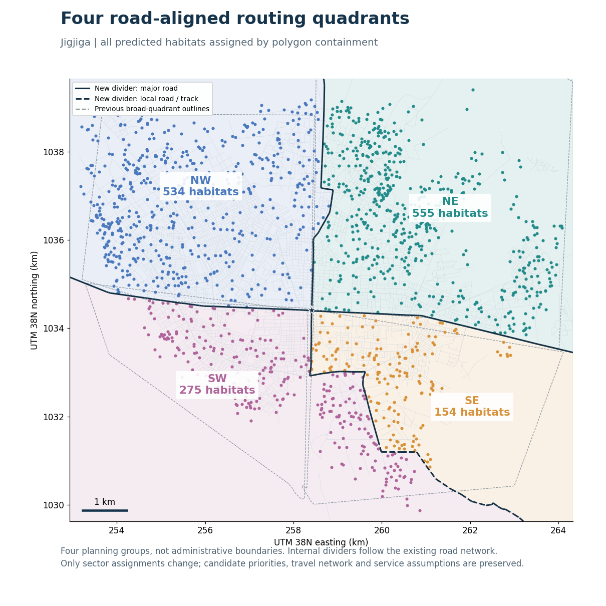

# Four road-aligned planning quadrants

The live Jigjiga **Predicted** scenario now uses NE, NW, SE and SW planning polygons instead of copying 21 small-area labels from the nearest historical habitat. Historical campaigns and the original `route_sim_data.js` remain unchanged.



## Boundary definition

The four large polygons in `Jigjiga_sectors_20250905.kmz` supply approximate directions and the central junction. Internal dividers follow mapped roads in `road_network_20260106.shp`, with preference for trunk, secondary and tertiary roads. Southern continuity requires unclassified-road and track sections; these are dashed on the map and in the app. Do not describe every segment as a major highway.

The shared construction tree is weighted by road length, road class and distance from the original divider directions. This is a reproducible planning choice, not an optimized or official administrative partition. The outer envelope is the candidate bounding rectangle plus 250 m. All internal boundary segments follow actual road geometries; no straight extrapolation is used. Driving continues to use the original directed travel graph, not the boundary-construction network.

Assignments use polygon containment in EPSG:32638, not historical habitat labels. Exact boundary ties use the fixed order NE, NW, SE, SW; there are no ties for the shipped candidates. Counts: NE 555, NW 534, SE 154, SW 275. All 1,518 candidates retain their original locations, priority values, road-node connections and depot.

## Reproduce and verify

From the repository root, with Python packages numpy, geopandas, shapely, pyproj, networkx and matplotlib installed:

```text
python analysis/road_quadrants/build_road_quadrants.py
python analysis/road_quadrants/verify_spatial.py
node analysis/road_quadrants/verify_routes.cjs
```

Optional UI verification, with Python Playwright and its Chromium browser installed: `python analysis/road_quadrants/verify_browser.py`. The test starts and closes its own temporary local server.

The input GeoJSON snapshots make reconstruction independent of the original Windows workspace. Road geometries originate from OpenStreetMap; retain OpenStreetMap contributor attribution and applicable ODbL terms when redistributing the road extracts. The historical broad-quadrant outlines are retained solely as planning references.

`route_simulation.html` loads the new generated data and displays the four boundaries. Solid purple dividers are major roads; dashed sections are local roads or tracks. Historical scenarios do not display these planning boundaries. `route_simulation_four_quadrants.html` is an equivalent generated standalone entry point.

## Scope and interpretation

Only grouping changes. Sector sweep still selects the group with the largest total priority divided by entry driving time plus access/service time, then visits its nearest remaining habitat by road distance until that group is complete. Internal driving is counted in execution time but omitted from the group-selection score. Multiple teams claim groups exclusively. These are heuristic routes, not guaranteed optimal solutions.

Tests compare old/new grouping with 1, 2 and 3 teams, four algorithms, identical travel and service assumptions. All 24 routes visit every candidate exactly once. Greedy, nearest-neighbour and zigzag visit sequences and days remain identical; sector-sweep routes change. At one team, 25 km/h driving, 4.3 km/h walking, 10 minutes/service and 8 hours/day, total sector-sweep working time changes from 44.086 to 43.582 days, but time to 80% mapped priority increases from 30.394 to 33.828 days. Thus the clearer partition is not a claim of better priority coverage at every budget.

Manuscript figures and earlier archived analyses were not overwritten. Their old sector-sweep results must not be presented as results for these new quadrants. All coverage values remain predicted-priority coverage, not observed treatment benefit.
